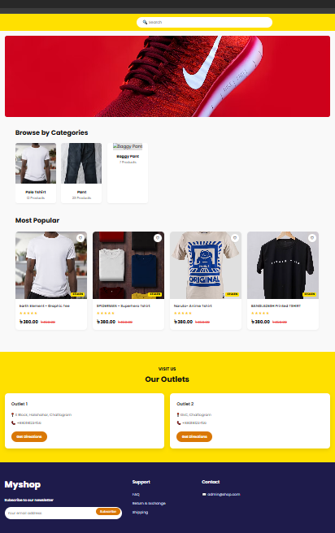
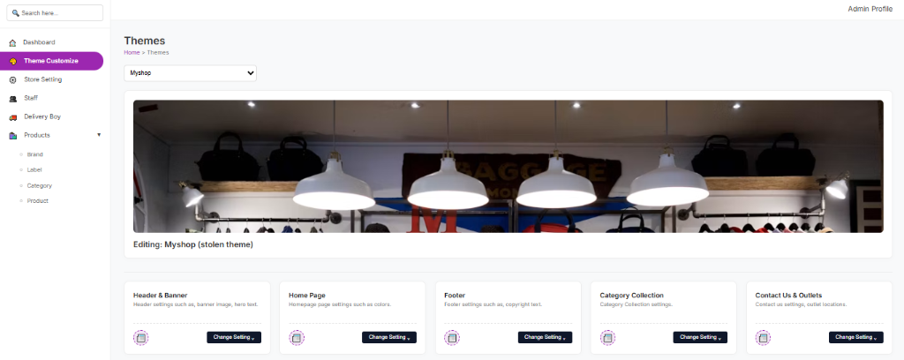
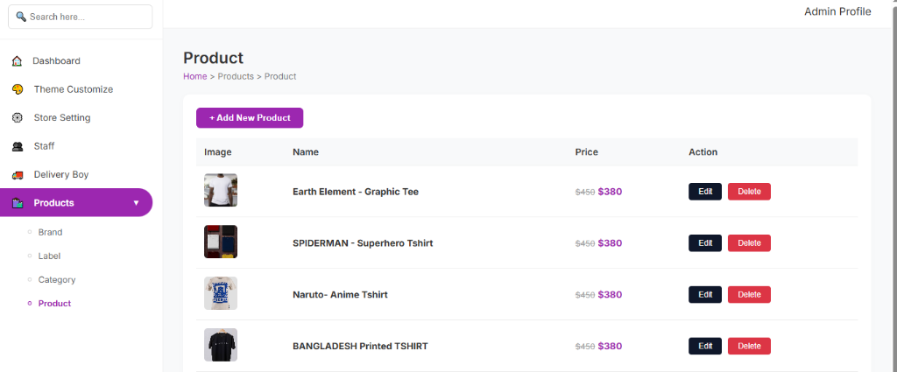
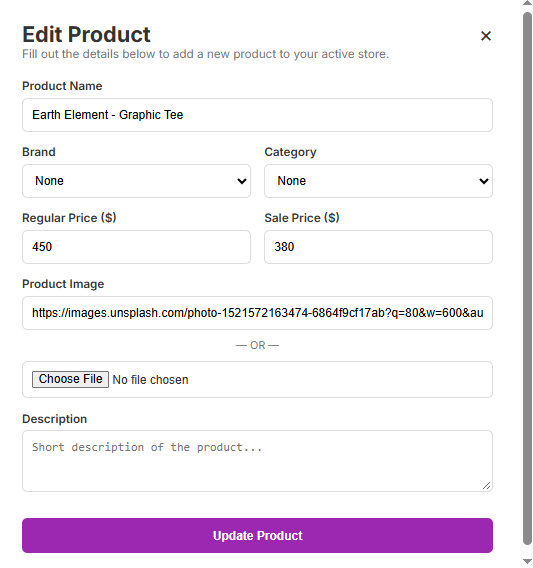
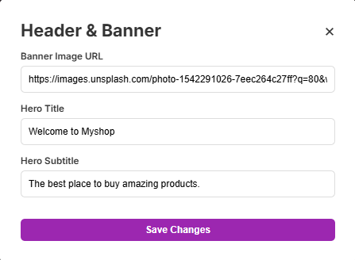

# ZeroBuildStdio 🚀

<div align="center">


**A Blazing-Fast, Framework-less Multi-Tenant SaaS E-Commerce Platform**  
*Engineered 100% with Python Standard Library (`http.server`) & Vanilla JavaScript.*

[Explore Features](#-key-features) • [Application Showcase](#-application-showcase) • [Tech Stack](#-technical-architecture) • [Getting Started](#-installation--local-setup) • [Jira Agile Tracking](#-academic-project--agile-tracking)

</div>

---

## 📖 Overview

**ZeroBuildStdio** is a lightweight, high-performance Software-as-a-Service (SaaS) e-commerce website builder tailored for small and medium businesses. 

Unlike conventional platforms that rely on heavyweight web frameworks (such as Django, Flask, Next.js, or Laravel), **ZeroBuildStdio is built strictly from the ground up using pure Python standard libraries and vanilla frontend technologies**. It demonstrates that robust multi-tenancy, dynamic theme customizers, and real-time storefront rendering can be achieved with zero framework overhead, resulting in lightning-fast load times, minimal memory consumption, and zero external dependency vulnerabilities.

---

## 📸 Application Showcase

### 1. Dynamic User-Facing Storefront (`/s/<subdomain>`)
A fully responsive, server-rendered storefront generated on-the-fly based on tenant customization, active catalog items, and branding colors.
<div align="center">
  
</div>

### 2. Admin Dashboard & Live Theme Customizer
Store owners can configure header banners, hero typography, color schemes, category layouts, and outlet locations with an interactive real-time preview.
<div align="center">
  
</div>

### 3. Product Catalog & Inventory Management
Effortless product CRUD operations supporting dual pricing (Regular vs. Promotional Sale Price), stock variations, and direct image pipeline.
<div align="center">
  
</div>

### 4. Interactive Configuration Modals
Modern, modal-driven workflows for creating products, uploading Base64 media, and updating banner configurations.
<div align="center">
  <table>
    <tr>
      <td align="center"><b>Product Editor Modal</b></td>
      <td align="center"><b>Header & Banner Customizer</b></td>
    </tr>
    <tr>
      <td></td>
      <td></td>
    </tr>
  </table>
</div>

---

## ✨ Key Features

- **Multi-Tenant SaaS Architecture:**
  - Instant subdomain routing (e.g. `http://localhost:8000/s/myshop`) with isolated tenant data namespaces.
  - Multi-store creation and independent store administration.

- **Framework-less Backend Engine:**
  - Custom REST routing engine built on Python's native `http.server.BaseHTTPRequestHandler`.
  - Dispatches `GET`, `POST`, `PUT`, and `DELETE` requests with CORS support, regex URL parsing, and unified JSON error handling.

- **Dynamic Server-Side Storefront Renderer (SSR):**
  - Pure Python template generation in `storefront_renderer.py` that compiles clean semantic HTML and CSS without frontend build tools.

- **Catalog & Pricing Engine:**
  - Dual pricing structure: Regular price with strike-through and highlighted discounted sale price (e.g., ৳380 vs. ৳450).
  - Base64 in-memory image encoding eliminating the need for expensive third-party image hosting services.

- **No-Code Theme Customizer:**
  - Real-time adjustment of banner images, hero headlines, category collections, and branch outlets.

- **Modular Persistence:**
  - Clean abstracted data layer with local JSON fallback and ready connectors for cloud databases like Firebase Firestore.

---

## 🛠️ Technical Architecture

| Layer | Technology | Details |
| :--- | :--- | :--- |
| **Backend** | Python 3.11+ (Standard Library) | `http.server`, `urllib`, `json`, `base64`, `re` (Zero external frameworks) |
| **Frontend** | Vanilla JavaScript (ES6+), HTML5, CSS3 | Pure DOM manipulation, CSS Grid & Flexbox, Modal workflows |
| **Data Layer** | Local JSON Store / Firebase Sync | Atomic read/write operations with tenant isolation |
| **Agile Management**| Jira Software & GitHub | Sprint planning, Kanban tracking, Smart Commits |
| **Documentation** | BUBT SWE Lab Standards | Formal SRS document, SDLC selection, and project proposal |

---

## 📁 Project Structure

```bash
ZeroBuildStdio/
├── controllers/              # Application business logic controllers
│   ├── product_controller.py # Product CRUD, pricing calculations & Base64 image logic
│   └── shop_controller.py    # Multi-tenant shop management & configuration
├── utils/                    # Core helpers
│   └── response_util.py      # Standardized JSON response & CORS header dispatchers
├── docs/                     # Official academic project reports & documentation
│   ├── Lab_02_Software_Development_Approach_Selection.pdf
│   ├── Lab_03_Software_Requirements_Specification_SRS.pdf
│   └── Project_Proposal_ZeroBuild_Studio.pdf
├── screenshots/              # High-resolution application UI screenshots
│   ├── storefront_preview.png
│   ├── theme_customizer.png
│   ├── product_management.png
│   ├── edit_product_modal.png
│   └── header_banner_settings.png
├── server.py                 # Application entrypoint & HTTP server runner (Port 8000)
├── routes.py                 # REST request router & URL dispatcher
├── dashboard_renderer.py     # Admin panel dynamic UI generator
├── storefront_renderer.py    # Dynamic user-facing storefront renderer
├── firebase_config.py        # Cloud database integration connector
├── requirements.txt          # Python dependencies (Optional cloud modules)
└── .gitignore                # Git ignore rules (clean Python/bytecode filtering)
```

---

## ⚙️ Installation & Local Setup

### 1. Clone the Repository
```bash
git clone https://github.com/mdshirajulislam/ZeroBuildStdio.git
cd ZeroBuildStdio
```

### 2. Run the Application
Because **ZeroBuildStdio** uses 100% Python standard libraries, **no external package installation is required** to run the core server:
```bash
python server.py
```

### 3. Access in Browser
- **Admin Dashboard (Theme & Product Panel):**  
  👉 [`http://localhost:8000/`](http://localhost:8000/)
- **Live Tenant Storefront:**  
  👉 [`http://localhost:8000/s/myshop`](http://localhost:8000/s/myshop)
- **API Endpoints:**  
  - Products API: `http://localhost:8000/api/products`  
  - Shops API: `http://localhost:8000/api/shops`

---

## 📌 Academic Project & Agile Tracking

This project was developed as part of the **Software Engineering Lab (CSE 328)** curriculum at **Bangladesh University of Business & Technology (BUBT)**.

### 👥 Team Contributors
| Name | Student ID | Intake & Section | Core Responsibilities |
| :--- | :--- | :--- | :--- |
| **Md Shirajul Islam** | **20245103198** | Intake 53, Sec 05 | **Project Lead**, Backend Core Routing & SaaS Architecture |
| **Md Sad Ullah** | **20245103163** | Intake 53, Sec 05 | Multi-Tenant Database Architecture & Shop Controller Logic |
| **Sanjana Zarin** | **20245103169** | Intake 53, Sec 05 | Customer Shopping Cart Engine & Checkout Processing Workflow |
| **Abdullah Al Shawon** | **20245103200** | Intake 53, Sec 05 | Product Search, Category Filter Engine & POS Module |
| **Arpita Sannamat** | **20245103026** | Intake 53, Sec 05 | Storefront SSR Engine & Dynamic Theme Customizer |

### 👩‍🏫 Supervised By
**Nahida Akter Tanjila**  
Lecturer, Department of Computer Science and Engineering  
**Bangladesh University of Business and Technology (BUBT)**

---

### 📊 Jira Project Management
Development follows an **Agile - Incremental Development Model** managed actively via Atlassian Jira:
- **Jira Kanban Board:** [ZeroBuildStdio Live Jira Board](https://mdshirajulislam.atlassian.net/jira/software/projects/KAN/boards/2?filter=&groupBy=none)
- **Key Epics & Milestones:**
  - `KAN-4`: Core Backend Architecture & Multi-Tenant Engine
  - `KAN-5`: Product Management & Media Architecture
  - `KAN-6`: Storefront Engine & Admin Dashboard Experience
  - `KAN-7`: Checkout Workflow, Testing & Course Deliverables
- **Official Documentation Available in `/docs`:**
  - `Lab_02`: Software Development Approach Selection Report
  - `Lab_03`: Formal Software Requirements Specification (SRS Document with 33 FRs & 14 NFRs)
  - `Proposal`: Complete ZeroBuild Studio SaaS E-Commerce Project Proposal

---

## 📝 License
This project is open-source and released under the [MIT License](LICENSE).

<div align="center">
  <i>Developed with precision and passion by Md. Shirajul Islam & Team (BUBT CSE 53).</i>
</div>
